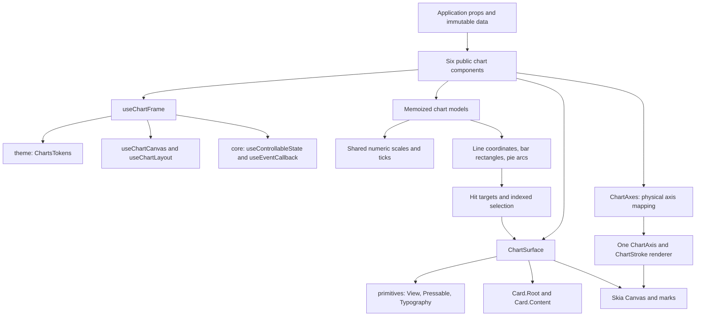

# Charts implementation and architecture

The six public charts share one frame, presentation layer, visual defaults, and
Cartesian axis renderer. Chart-specific code supplies only its model, drawable
marks, hit targets, and legend entries. Public chart props and utility entrypoints
remain compatible with the previous implementation. Direct Skia primitive composition requires an explicit theme prop, as described below.



## Package ownership

| Owner                | Reused capability                                                                | Chart usage                                                                                             |
| -------------------- | -------------------------------------------------------------------------------- | ------------------------------------------------------------------------------------------------------- |
| `core`               | Generic-preserving `memo`, stable event callbacks, controlled/uncontrolled state | Components, responder handlers, selection, and visibility.                                              |
| `theme`              | Primitive scales, component tokens, theme provider, themed styles                | Shared chart typography, palette, insets, rounding, marker geometry, and legend/tooltip placement.      |
| `primitives`         | `View`, `Pressable`, `Typography.Master`                                         | Native frame/overlays, legend press feedback, text/font resolution, swatches, and tooltip rows.         |
| `card`               | `Card.Root`, `Card.Content`                                                      | Tooltip surface, border, rounding, content spacing, and theme customization.                            |
| `charts`             | Chart-specific models, axes, hit testing, and rendering                          | Geometry and presentation contracts that depend on chart data.                                          |
| `storybook`          | Documentation pages and native examples                                          | Basic usage, edge cases, controlled interactions, and six-chart light/dark comparison galleries.        |
| `toolkit`            | Public aggregation                                                               | Re-exports the charts package; contains no chart implementation.                                        |
| Skia                 | Canvas, shapes, paths, paragraphs                                                | Native rendering.                                                                                       |
| D3 array/scale/shape | Extents, scales, ticks, lines, pies, arcs                                        | Pure model and shape construction. D3's own transitive dependencies provide interpolation/time support. |

`data-state` remains an application-level composition option for loading/error
flows. Chart `emptyContent` renders the application's supplied node; charts do
not manufacture generic state actions. Modal/overlay/portal infrastructure is
unnecessary for the local, non-interactive tooltip.

## Public chart paths

| Component        | Model path                                                        | Marks                     | Legend identity                                                    |
| ---------------- | ----------------------------------------------------------------- | ------------------------- | ------------------------------------------------------------------ |
| `LineChart`      | `useLineChart` → shared line scales + coordinates                 | `Line`                    | No series legend.                                                  |
| `MultiLineChart` | `useMultiLineChart` → shared line scales + per-series coordinates | `Line` per visible series | Stable series ID.                                                  |
| `BarChart`       | `useBarChart` → band/numeric scales + shared rectangles           | `Bar`                     | No series legend.                                                  |
| `MultiBarChart`  | `useMultiBarChart` → grouped or stacked geometry                  | `Bar` per visible series  | Stable series ID.                                                  |
| `PieChart`       | `usePieChart` → positive finite slice proportions                 | `Pie`                     | Stable datum ID.                                                   |
| `MultiPieChart`  | `useMultiPieChart` → independently normalized rings               | `Pie` per visible ring    | Stable series ID; multicolor swatches reflect actual slice colors. |

All paths use `useChartFrame` and `ChartSurface`. Partial `insets` override the
same theme inset defaults for every chart. Cartesian charts additionally use
`ChartAxes`; horizontal bars swap physical axes without changing the logical
category/value API. Layouts clamp impossible sizes/insets to finite canvas bounds.

## Module map

Paths below are relative to `packages/charts/src` unless noted otherwise.

| Layer                | Modules                                                                                                                                                 | Responsibility                                                                                                                                                                          |
| -------------------- | ------------------------------------------------------------------------------------------------------------------------------------------------------- | --------------------------------------------------------------------------------------------------------------------------------------------------------------------------------------- |
| Public composition   | `components/{line,multi-line,bar,multi-bar,pie,multi-pie}-chart/*-chart.tsx`                                                                            | Connect frame, model, marks, targets, and legends.                                                                                                                                      |
| Shared frame         | `hooks/use-chart-frame.hook.ts`, `use-chart-canvas.hook.ts`, `use-chart-layout.hook.ts`                                                                 | Theme, native measurements/resizes, common insets, and frame options.                                                                                                                   |
| Shared state         | `hooks/use-chart-presentation.hook.ts`, `use-visible-chart-series.hook.ts`                                                                              | Controlled/uncontrolled selection, visibility, stable handlers, and visible series.                                                                                                     |
| Model hooks          | `hooks/use-line-chart-scale.hook.ts`, six `use-*-chart.hook.ts` modules                                                                                 | Memoization based on data, layout, domains, tick counts, and geometry options.                                                                                                          |
| Native presentation  | `components/chart-surface.tsx`, `chart-legend.tsx`, `chart-legend-item.tsx`, `chart-tooltip.tsx`, `chart-text.tsx`, `chart-swatch.tsx`, `chart-row.tsx` | Shared overlays, native text, press feedback, swatches, and Card tooltip.                                                                                                               |
| Axes                 | `components/chart-axes/chart-axes.tsx`, `primitives/{x-axis,y-axis,chart-axis,chart-stroke}.tsx`, `utils/axis.util.ts`                                  | Physical axis mapping, shared layout, stroke/tick/label rendering, and formatting.                                                                                                      |
| Marks and grid       | `components/primitives/{line,bar,pie,grid,label}.tsx`                                                                                                   | Memoized Skia rendering; hidden paths are not constructed.                                                                                                                              |
| Plot layout          | `utils/chart-layout.util.ts`                                                                                                                            | Finite size/inset resolution, plot/axis regions, stroke clips, and compatibility inset geometry.                                                                                        |
| Grid paths           | `utils/grid.util.ts`                                                                                                                                    | Horizontal/vertical tick paths and shared grid style resolution.                                                                                                                        |
| Numeric scales       | `utils/{chart-scale,numeric-domain,chart-number,chart-ticks}.util.ts`                                                                                   | Finite validation, domains, extreme-magnitude normalization, tick counts, and categorical tick thinning.                                                                                |
| Line models          | `utils/{line-chart,multi-line-chart,line-coordinates,line}.util.ts`                                                                                     | Scale inference, gaps, isolated points, series styles, stroke-centered paths, and compatibility coordinate fitting.                                                                     |
| Bar models           | `utils/{bar-chart,multi-bar-chart,bar-geometry,bar-stack}.util.ts`                                                                                      | Shared category/value scales, orientation, one rectangle constructor, grouped offsets, and signed stacks.                                                                               |
| Radial models        | `utils/{pie-chart,multi-pie-chart,pie}.util.ts`                                                                                                         | Ratios, degree-to-radian conversion, overflow-safe proportions, ring layout, and arc paths.                                                                                             |
| Interaction          | `utils/chart-interaction.util.ts`, `chart-selection.util.ts`                                                                                            | Target construction, bar/sector containment, nearest line points, and category/series selection indexes.                                                                                |
| Appearance           | `utils/chart-color.util.ts`, `chart-theme.util.ts`                                                                                                      | Stable ID colors, shared native/Skia typography, and consistent axis/tooltip category formatting.                                                                                       |
| Paragraphs           | `utils/{paragraph-builder,label}.util.ts`                                                                                                               | Typeface provider selection, alignment, and paragraph positioning.                                                                                                                      |
| Contracts            | `types/*.types.ts`                                                                                                                                      | Public props/models plus focused internal frame, axis, stack, and selection types. `ChartContainerProps`, `ChartCartesianProps`, and `ChartCartesianScaleModel` carry shared contracts. |
| Defaults             | `constants/*.constants.ts`                                                                                                                              | Shape defaults, pure-hook theme defaults, and numeric safety thresholds. Existing public constants remain available.                                                                    |
| Public facades       | Root and local `index.ts` barrels                                                                                                                       | Export public APIs; frame/render implementation helpers remain internal.                                                                                                                |
| Theme factory        | `packages/theme/src/theme/create-charts-tokens.ts` and `types/charts-tokens.types.ts`                                                                   | Produce all chart appearance defaults from shared theme scales.                                                                                                                         |
| Verification         | `packages/charts/tests/*`, `scripts/charts-tests.mjs`                                                                                                   | Node model/hit-testing tests bundled with real pure theme factories. No native renderer mocks or new test runtime dependency.                                                           |
| Native documentation | `packages/storybook/src/stories/charts/*`                                                                                                               | Usage, selection, edge-case stories, and comparison galleries.                                                                                                                          |

## Visual contract

- Native text and Skia labels use the same chart `label` font family, weight,
  and size. Legends/axes use secondary color; tooltip values use primary content
  color. Axis-level label overrides take precedence.
- Marks use the chart palette and stable IDs. Datum/series colors override it.
- All charts share theme insets. Bar and pie rounding defaults come from the
  same radius scale, and explicit `radius`/`cornerRadius` override them.
- Selection markers use chart selection tokens. Legends and tooltips share
  swatches and native text; hidden legend opacity and press feedback come from
  the existing Pressable tokens.
- Tooltip surface styling comes from Card tokens. Charts own only tooltip
  placement and width constraints.
- Typography/selection/legend/tooltip token additions are optional in the full
  `ChartsTokens` contract, preserving older custom token objects. The theme
  factory always supplies them; missing additions fall back to primitive scales.
- Custom fonts must be loaded by the host. Supply a Skia `fontManager` for
  Cartesian labels when the native platform cannot resolve the registered font.

## Work avoided by the refactor

- Six frame setups and two independent axis renderers become shared modules.
- Native legends/tooltips reuse primitives and Card instead of rebuilding them.
- Scale hooks depend on geometry inputs, so label colors/fonts/dashes do not
  rebuild scales or coordinates. Theme padding changes still rebuild geometry.
- Single/multi-line charts share one scale hook; multi-line coordinates are
  generated once per series.
- Grouped bars skip stack aggregation. Stacked scale input contains two totals
  per unique category, rather than two repeated records per source datum.
- Grouped/stacked and vertical/horizontal bars share rectangle construction.
- Numeric scales and category tick thinning share one policy across chart types.
- Selection/category indexes are built when targets/layout change, then reused
  during selection updates. Touch containment still scans marks; no unmeasured
  spatial-index complexity is introduced.
- Per-series stroke clips are memoized with drawable line metadata.
- Hidden paths and absent empty content do not allocate render work.

These are structural reductions, not measured frame-rate claims. Use native
profiling with application-sized datasets before choosing decimation or a
spatial index. Node tests cover model/appearance contracts; the light/dark native
galleries are the visual acceptance surface for iOS and Android.

## Runtime setup and public API

Install `@impulse-ui-native/charts` and its host peers: React `>=18`, React Native `>=0.73`,
Skia `>=2`, Gesture Handler `>=2`, Reanimated `>=4`, and Worklets `>=0.5`.
The package directly depends on `core`, `theme`, `primitives`, and `card`, plus
D3 array, scale, and shape packages. Complete native gesture/runtime setup;
D3 interpolation and time helpers arrive through transitive dependencies.

Wrap the application in `GestureHandlerRootView` and `ThemeProvider` and give each chart a parent with a
measurable height. ChartSurface and its canvas use `flex: 1`; an unbounded or
zero-height parent cannot produce a drawable plot. Load the host fonts and pass
`fontManager` for Skia labels when needed.

```tsx
import { View } from "react-native";
import { GestureHandlerRootView } from "react-native-gesture-handler";

import { LineChart } from "@impulse-ui-native/charts";
import { ThemeProvider } from "@impulse-ui-native/theme";

export function RevenueChart() {
  return (
    <GestureHandlerRootView style={{ flex: 1 }}>
      <ThemeProvider>
        <View style={{ height: 280 }}>
          <LineChart
            data={[
              { x: "Mon", y: 12 },
              { x: "Tue", y: 18 },
            ]}
            interactive
            grid={{ y: {} }}
          />
        </View>
      </ThemeProvider>
    </GestureHandlerRootView>
  );
}
```

The package root exports chart components, the public Skia primitives, model
hooks, types, constants, and selected utilities through local barrels. The
`toolkit` aggregates this package. Internal frame, gesture, indexing, and
axis-renderer helpers are imported by their source modules and should not be
assumed to be public API merely because tsup emits their files.

Cartesian data is `{ x: number | string | Date, y: number | null }`. Multi-series
charts add a stable `id`, optional `label`, a data array, and per-series `line` or
`bar` options. Pie data is `{ id, value, color?, label? }`; multi-pie series own
separate pie data arrays. Use unique IDs and replace changed data arrays rather
than mutating them in place: memoization depends on immutable input references.

## Render lifecycle and coordinates

1. A public chart calls `useChartFrame(props)` outside the Skia canvas.
2. The frame reads the app theme, measures the canvas, resolves layout, and owns
   selection and hidden-ID state.
3. The chart filters hidden series and calls its memoized model hook with the
   resolved plot rectangle. Geometry is expressed in absolute canvas pixels.
4. The chart derives drawable styles, hit targets, and legend entries.
5. `ChartSurface` renders the native container, canvas, tooltip, and legend.
6. Cartesian charts render `ChartAxes` and their marks as canvas children;
   pie charts render their slice primitives.
7. Layout or data changes recompute affected models. Selection changes reuse
   model geometry and update markers and the tooltip.

`useChartCanvas` combines Skia's initial canvas measurement with native
`onLayout` updates. Repeated dimensions retain the previous state object.
`createChartLayout` normalizes dimensions and insets to nonnegative finite
values and proportionally shrinks excessive horizontal or vertical insets.
The result includes `size`, resolved `insets`, `plot`, `xAxis`, and `yAxis`.
The physical X-axis region sits below the plot; the Y-axis region sits to its
left. Insets reserve this space even when an axis is hidden.

## Theme context across the Skia boundary

Skia Canvas creates its own React rendering root for its children. The app's
ThemeProvider does not automatically provide context to that root. A canvas
primitive calling `useTheme()` or `useComponentsTokens()` can therefore throw
`useThemeContext must be used within a ThemeProvider` even with a valid app
provider.

Resolve the theme before entering Canvas and pass it as data. `Bar`, `Line`,
`Pie`, `Grid`, axis renderers, and `Label` receive an explicit `theme` prop.
Native ChartText, ChartTooltip, and legend components remain in the application
React tree and can use theme hooks normally.

```tsx
import { Canvas } from "@shopify/react-native-skia";

import { Line, useLineChart } from "@impulse-ui-native/charts";
import { useTheme } from "@impulse-ui-native/theme";

// Render this component beneath the application's ThemeProvider.
export function CustomLine() {
  const theme = useTheme();
  const model = useLineChart({
    data: [
      { x: 0, y: 2 },
      { x: 1, y: 5 },
    ],
    plot: { x: 16, y: 16, width: 240, height: 140 },
  });

  return (
    <Canvas style={{ width: 272, height: 172 }}>
      <Line coordinates={model.coordinates} theme={theme} />
    </Canvas>
  );
}
```

Theme changes propagate through those explicit props. Visual defaults come
from `theme.components.charts`; explicit styles override the defaults. The
primitive `theme` prop is required, including when every visual style is
specified. This is a migration requirement for consumers composing primitives
directly; the six public chart components supply it internally.

## Cartesian scale and geometry implementation

### Shared numeric scales and ticks

`normalizeNumericDomain` repairs nonfinite domains to `[0, 1]` and expands equal
endpoints by `max(1, abs(value) * 0.05)` while preserving finite bounds.
`createChartNumericScale` scales extreme magnitudes into a safe unit before
asking D3 to interpolate, preventing overflow in the domain difference. It
converts ticks back into data units, rejects nonfinite ticks, and clamps nice
bounds to finite values. Inferred Y domains may be made nice; explicit Y domains
are preserved after normalization.

`getChartTickCount` normalizes the requested count to a nonnegative integer.
`selectChartTicks` shares category thinning between lines and bars: zero yields
no ticks, one yields the first category, and larger counts retain the first and
last categories while sampling evenly by index.

### Line and multi-line models

`createLineChartScaleModel` infers X scale type from the first valid X value:
strings use point scales, numbers use linear scales, and Dates use time scales.
`xScaleType` can override this. Invalid X values and nonfinite Y values cannot
produce drawable coordinates. Empty and single-value domains receive usable
fallbacks. Coordinates retain the original datum and input index, with null
pixel coordinates representing gaps.

`useLineChartScale` depends on data, plot, X scale type, tick counts, and Y domain.
`useLineChart` derives coordinates from that scale model. Multi-line charts use
the same scale hook for flattened series data and generate coordinates once per
series. Hidden series are removed before deriving the shared domain.

`createLinePath` uses D3's linear or monotone-X curve without sorting input.
Consumers should provide ordered numeric/date X values for monotone curves.
Missing points break paths. An isolated valid point is excluded from the path
and drawn as a Circle with radius `line.width / 2`, so single-point datasets and
measurements between gaps remain visible.

`createDrawableMultiLineChartSeries` resolves stable series colors and width
without fitting points into a different rectangle. The exported
`fitLineCoordinatesToRect` utility remains available for existing consumers;
the main chart rendering path keeps coordinates centered on the actual scales.

### Bar and multi-bar models

`createBarChartScaleModel` builds a category band scale and a shared numeric
value scale. Bar categories remain discrete even when their values are numbers
or Dates. Equal timestamps share a band. The X scale exposed to axes points at
band centers; the internal start scale locates rectangle edges. Inferred value
domains include zero. The baseline and rectangle constructor support negative
values and explicit domains.

`categoryPadding` and `seriesPadding` are normalized ratios in `[0, 1]`.
Grouped multi-bars use a secondary band scale within each category, so reordered
or missing categories across series stay aligned. Stacked mode maintains
separate positive and negative offsets per category. Domain aggregation emits
two totals per unique valid category, retaining categories whose values are
null. Accumulation saturates at finite numeric limits.

`createBarChartRectangle` is shared by grouped, stacked, horizontal, and vertical
bars. Orientation maps the category and numeric axes into physical pixel axes;
logical `xAxis` remains category configuration and `yAxis` remains value
configuration. `ChartAxes` performs the matching physical swap. Bar corner
radius is capped by half the rectangle width and height. Marks stay clipped to
the plot, and hit targets for partially clipped bars anchor inside the visible
portion.

## Pie and ring geometry

`createPieChartModel` accepts only positive finite values. It preserves original
datum indices, disables D3 sorting, and converts input angles from degrees to
radians. Values are divided by the largest value before angle calculation so
large finite totals cannot overflow and collapse all slice proportions. The
reported total is capped at Number.MAX_VALUE.

Radius options are ratios of half the smaller plot dimension. Ratios are
clamped to `[0, 1]`, the inner radius cannot exceed the outer radius, and the
center is the plot midpoint. Empty inputs or zero outer radius return no marks.
`Pie` builds slice paths with theme/default corner radius, datum-level colors,
and optional stroke styling.

`createMultiPieChartModel` divides the radial span among the visible series.
Series order runs from the outer ring inward. Ring padding is limited to the
available span; each ring normalizes its own values independently. Arc pad
radius is shared across rings to maintain consistent angular padding behavior.
Hiding a ring recomputes radial allocation for the remaining rings.

## Axes, grid, labels, and appearance

`ChartAxes` maps logical scale/tick/options objects to the physical renderers.
`XAxis` and `YAxis` delegate to one `ChartAxis`. Pure axis layout utilities
return the axis line, tick endpoints, and label rectangles. `ChartStroke` owns
Skia stroke rendering and dash effects.

Axes render unless their `visible` option is false. Grid rendering is enabled
when a `grid` object is supplied; each direction resolves its own visibility and
style. Axis line, tick, and label options can be controlled independently.
`formatAxisTick` and target-label formatting share Date formatting, and a custom
category formatter is reused by tooltip labels.

`Label` uses Skia paragraphs, with optional font manager, ellipsis, max lines,
alignment, rotation, and tabular numeric features. `resolveChartLabelTokens`
falls back to primitive-derived label tokens when older custom chart token
objects omit the optional label section. Native ChartText applies the same
font family, weight, size, and label color through Typography.Master.

`getChartColor` hashes stable IDs into the theme palette. Reordering or hiding
series does not change colors while IDs and the palette remain stable. Empty
palettes resolve to transparent. Single line/bar charts default to the first
palette entry; pie datum colors and explicit series colors take precedence.

## Selection, visibility, and presentation

`ChartSelection` stores `{ seriesId?, datumIndex }`. Indices refer to the
original data array, including when invalid values were omitted from marks.
Keep series/datum IDs stable and update a controlled selection when replacing
or reordering its source data.

`useChartPresentation` uses core's `useControllableState` for both selection and
hidden IDs. `selection`/`hiddenIds` select controlled behavior; the corresponding
`default*` props initialize uncontrolled state. Change callbacks notify the
host. `selectAt` retains an equivalent selection object and accepts an optional
`clearOnMiss` argument (true by default for direct hook consumers). The native
gesture hook passes false during touch-down and movement. Legend toggles retain
selection; hidden selected values stop rendering until made visible again.

`ChartSurface` wraps only the native canvas view in `GestureDetector`.
`useChartGesture` creates a manually activated native pan recognizer. Its
`onTouchesDown` worklet schedules selection from the first changed touch's
local X/Y coordinates before activating on the UI thread. Taps do not wait for
the pan's ACTIVE transition. Activation claims the touch before a parent scroll
gesture begins. Native local X/Y coordinates are
scheduled onto the React Native thread with `scheduleOnRN`; selection state
and hit testing remain there. Gestures stay active outside the canvas and use
one pointer. Disabled or zero-size charts do not activate.

`updateChartGestureState` records whether the gesture hit a mark or exceeded
the eight-pixel tap slop. Drag misses preserve selection. Successful release
flushes a drag's final native position without clearing on a miss; an empty
tap clears selection. Touch-down also snapshots whether the hit belongs to
the current selected target group; a completed tap on that group dismisses it.
For multi-line charts, any highlighted point in the same category can dismiss
the shared tooltip. Dragging never uses this toggle behavior. Finalization resets tracking without clearing it.
Scrolling begins outside the interactive canvas. This uses the same native
ownership pattern as Slider and the color spectrum, replacing PanResponder.

Hit testing rejects points
outside the plot, tests rectangle containment for bars, radius/angle/padding
containment for pies, and selects the nearest drawable point for lines. Line
selection has no additional distance threshold within the plot.

`createChartHitIndex` builds maps by series/index and by category when targets or
layout change. Selected line points collect details from all visible series
at the same typed category key. Numbers, strings, and Dates use distinct key
namespaces; equivalent Date timestamps share a key. Bar selections return the individual bar; pie selections return the
individual slice. Targets absent from the visible index produce no marker or
tooltip.

The default tooltip is a native Card with shared ChartRow, ChartSwatch, and
ChartText. It renders above the canvas, outside GestureDetector, and uses chart
tokens for placement and maximum width. The default Card is wrapped in a native
Pressable; tapping it calls `clearSelection`, which sends null through the
controlled/uncontrolled selection setter. Tooltip taps cannot start a chart
gesture and reselect a point underneath. Custom content receives touch events
and retains its own actions. `tooltip={false}` hides it; a renderer
function receives the selected detail array. `legend` enables available entries
for multi charts and PieChart. Multi-pie legend swatches show the ring's positive
slice colors. Hidden entries remain available for toggling back on.

`emptyContent` is rendered over a measurable plot when there are no hit targets.
The chart renders supplied content directly and does not create application
loading or error actions. Selection may also be supplied programmatically while
native interaction is disabled.

## Clipping policy and edge markers

Clip bounds and data bounds serve different purposes. Data coordinates stay on
the scales, while paint may extend into the surrounding inset.

| Paint                          | Clip policy                                                                                 |
| ------------------------------ | ------------------------------------------------------------------------------------------- |
| Bars                           | Exact plot rectangle.                                                                       |
| Line strokes and isolated dots | Plot expanded by half the resolved line width, bounded by canvas size.                      |
| Selection rings                | Plot expanded by selection radius plus half selection stroke width, bounded by canvas size. |
| Pie slices                     | Radius geometry fits inside the plot; no Cartesian mark clip.                               |

`createChartStrokeClip(plot, width, size)` expands by `width / 2`. ChartSurface
uses `selectionRadius * 2 + selectionWidth` as that width, sharing the exact
radius and width values with Circle rendering. Clipping rings to `layout.plot`
would cut off their outer halves at minimum, maximum, first, or last points.
Canvas itself remains a hard boundary: custom zero insets or unusually large
markers still require sufficient surrounding space to show their entire paint.
Hit testing stays constrained to the plot even when paint extends beyond it.

## Performance and extension rules

Memoization separates geometry inputs from appearance inputs. Keep arrays and
options immutable so hooks can reliably detect changes. Theme insets and bar
spacing are geometry inputs; colors, label fonts, dashes, and stroke widths do
not need to rebuild data scales. Stroke-width changes do update clips and path
paint. Controlled selection changes reuse the hit index when targets are stable.

Touch hit testing still scans targets and is O(number of targets). Model work is
proportional to input size; the implementation does not perform decimation,
virtualization, or native profiling automatically. These should be driven by
measured application workloads. No frame-rate improvement is claimed here.

When extending charts:

1. Put pure geometry or domain helpers in `utils` and contracts in `types`.
2. Reuse the frame, surface, scales, axes, and existing package primitives.
3. Read context outside Canvas and pass required values into Skia children.
4. Derive hit targets from the same coordinates used to paint marks.
5. Preserve original datum indices and stable identity for selections/colors.
6. Keep model-hook dependencies focused on geometry; resolve appearance later.
7. Add theme tokens for reusable visual defaults and supply compatibility
   fallbacks for optional additions.
8. Export intentional public APIs through the relevant barrels and verify
   standalone package dependencies and peers.
9. Add model/interaction regression cases and native Storybook examples, update
   README/roadmap documentation, and add a Changeset for release-worthy changes.

Legacy public helpers and body-prop types may remain exported for consumer
compatibility even though the old body components and empty context barrel were
removed. Do not remove those types/utilities solely because internal code no
longer uses them without assessing the public API change.

## Verification and debugging

```powershell
pnpm.cmd --filter @impulse-ui-native/charts typecheck
pnpm.cmd --filter @impulse-ui-native/charts test
pnpm.cmd --filter @impulse-ui-native/charts build
pnpm.cmd --filter @impulse-ui-native/theme typecheck
pnpm.cmd --filter @impulse-ui-native/storybook typecheck
```

Use `pnpm` on shells without Windows PowerShell's script-execution restriction.
The test script bundles `tests/models.test.ts` with tsup into a temporary
location, substitutes a pure theme entry exposing real theme factories, runs
Node's test runner, and removes its temporary output. It exercises numerical
models, layouts, appearance defaults, hit testing, category grouping, stacking,
pie proportions, and clipping geometry. It does not run native components or
mock the Skia renderer.

At the documentation update on 2026-10-14, all 31 chart tests, chart typecheck and
build, and theme/Storybook typechecks passed. Package lint is unavailable because
ESLint 9 cannot find a flat configuration; no new ESLint configuration was
introduced. Native visual acceptance remains pending.

Use the Storybook selection example and consistency galleries to check all six
charts in light/dark themes on iOS and Android. Verify edge selection rings,
line caps, null gaps, isolated points, signed grouped/stacked bars, horizontal
axes, ring padding, custom fonts, theme overrides, rotation/resizing, tooltips,
legend toggles, controlled state, and empty plots. Geometry tests do not replace
these renderer and touch checks.

| Symptom                            | First checks                                                                                               |
| ---------------------------------- | ---------------------------------------------------------------------------------------------------------- |
| Theme-context exception            | ThemeProvider in the app tree; no theme hooks inside Canvas children; explicit primitive theme props.      |
| Blank chart                        | Parent height, measured canvas size, excessive insets, invalid data, hidden IDs, or invisible mark styles. |
| Missing text                       | Loaded native font family, Skia fontManager, label visibility, reserved axis space.                        |
| Cut-off edge dots                  | Selection clip uses ring diameter plus stroke width; enough canvas inset remains around the plot.          |
| Unexpected line shape              | Data ordering, inferred/explicit X scale type, null gaps, and explicit Y domain.                           |
| Wrong selection after data changes | Original datum index and series identity; controlled state must follow replaced/reordered data.            |
| Stale model after edits            | Mutated arrays/options; replace references consumed by memoized hooks.                                     |

See [the package README](../packages/charts/README.md) for consumer-facing usage,
[the chart stories](../packages/storybook/src/stories/charts/charts.stories.tsx)
for native examples, and [the model tests](../packages/charts/tests/models.test.ts)
for executable edge-case contracts.
